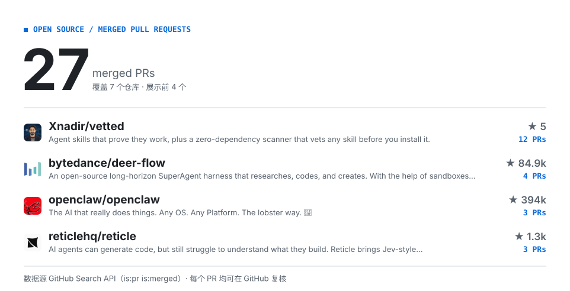

<picture>
  <source media="(prefers-color-scheme: dark)" srcset="./assets/hero-dark.svg">
  
</picture>

<!-- CONTRIB:BEGIN -->
<picture>
  <source media="(prefers-color-scheme: dark)" srcset="./assets/contrib-dark.svg">
  
</picture>
<!-- CONTRIB:END -->

查看贡献明细与统计口径

截至 2026-11-02，已核实 **27 个公开已合并 PR**，覆盖 **7 个仓库**。按账号名排除 `xyi74976-del` 名下仓库；仓库 star 是项目关注度，不代表个人成果。

- [Xnadir/vetted](https://github.com/search?q=author%3Axyi74976-del%20type%3Apr%20is%3Amerged%20is%3Apublic%20repo%3AXnadir/vetted&type=pullrequests)：12 个已合并 PR
- [bytedance/deer-flow](https://github.com/search?q=author%3Axyi74976-del%20type%3Apr%20is%3Amerged%20is%3Apublic%20repo%3Abytedance/deer-flow&type=pullrequests)：4 个已合并 PR
- [openclaw/openclaw](https://github.com/search?q=author%3Axyi74976-del%20type%3Apr%20is%3Amerged%20is%3Apublic%20repo%3Aopenclaw/openclaw&type=pullrequests)：3 个已合并 PR
- [reticlehq/reticle](https://github.com/search?q=author%3Axyi74976-del%20type%3Apr%20is%3Amerged%20is%3Apublic%20repo%3Areticlehq/reticle&type=pullrequests)：3 个已合并 PR
- [sineframe/m3](https://github.com/search?q=author%3Axyi74976-del%20type%3Apr%20is%3Amerged%20is%3Apublic%20repo%3Asineframe/m3&type=pullrequests)：2 个已合并 PR
- [KLK-code/frame-vault](https://github.com/search?q=author%3Axyi74976-del%20type%3Apr%20is%3Amerged%20is%3Apublic%20repo%3AKLK-code/frame-vault&type=pullrequests)：2 个已合并 PR
- [pydantic/pydantic-ai](https://github.com/search?q=author%3Axyi74976-del%20type%3Apr%20is%3Amerged%20is%3Apublic%20repo%3Apydantic/pydantic-ai&type=pullrequests)：1 个已合并 PR

[复核全部公开已合并 PR](https://github.com/search?q=author%3Axyi74976-del%20type%3Apr%20is%3Amerged%20is%3Apublic%20-user%3Axyi74976-del&type=pullrequests)

## 代表作品

- **[Incident Diagnosis Agent](<https://github.com/xyi74976-del/incident-diagnosis-agent>)**：基于本地场景数据的故障诊断演示：编排指标、日志与链路工具，记录证据和执行轨迹，为高风险处置保留人工审批。
- **[Ecommerce Decision Agent](<https://github.com/xyi74976-del/ecommerce-decision-agent>)**：基于本地场景数据的电商售后决策演示：汇集订单、支付与物流证据，识别信息冲突，生成带审批要求的建议与回复草稿。

## 更多信息

[GitHub](<https://github.com/xyi74976-del>) · [公开项目](<https://github.com/xyi74976-del?tab=repositories>)
